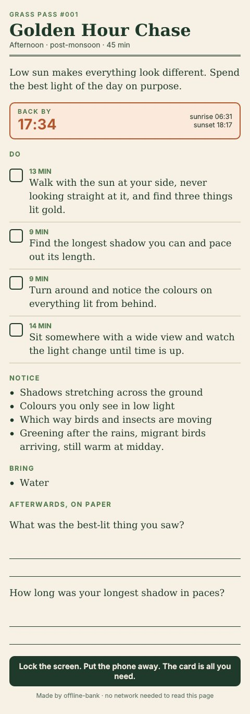

# Grass Pass

Offline-first field cards that get you off the screen and outside.

You tell it where you are, how long you have and how you feel. It writes a one-page card for a walk (steps with minutes, things to notice, what to bring, questions to answer on paper afterwards) with a big **Back by** time on it. Then it gets out of the way: the card is a plain HTML page with no network requests, so you print it or save it to your phone, lock the screen, and go.



> Open `examples/sample-card.html` in a browser to see the real page, or read `examples/sample-card.md`. This sample came from the offline quest bank.

## Why open-weight, local models

- **Works with no signal.** Generation runs against a model on your own machine. With no model at all, a built-in offline quest bank takes over.
- **Your location and mood stay on your machine.** Nothing is sent anywhere unless you point `GRASSPASS_BASE_URL` somewhere else.
- **Swap the engine.** The client speaks the OpenAI-compatible chat protocol, so Ollama, llama.cpp's `llama-server`, LM Studio and vLLM all work by changing two environment variables.
- **Free to retry.** A rejected card costs nothing to regenerate.

## Quick start

No dependencies, Python 3.10+ (developed and tested on 3.13).

```bash
# 1. (optional) a local model; the default is Gemma 3 4B on Ollama
ollama pull gemma3:4b

# 2. make a card
python -m grasspass quest --lat 22.3072 --lon 73.1812 --tz 5.5 \
    --minutes 45 --mood curious --weather "warm, humid, partly cloudy" \
    --terrain "campus and nearby park" --save-location

# afterwards, location is remembered:
python -m grasspass quest --minutes 30 --mood stressed

# no model installed? skip it explicitly:
python -m grasspass quest --offline
```

Cards are saved to `~/.grasspass/cards/` as `.html` and `.md` (override the folder with `GRASSPASS_HOME`).

After the walk:

```bash
python -m grasspass done 1 --minutes 40 --note "found the kingfisher spot"
python -m grasspass list
python -m grasspass stats
```

### Using a different model or runtime

```bash
export GRASSPASS_MODEL=qwen3:8b                      # any model your server has
export GRASSPASS_BASE_URL=http://localhost:8080/v1   # e.g. llama-server instead of Ollama
```

Also read: `GRASSPASS_API_KEY`, `GRASSPASS_TIMEOUT` (seconds, default 120), `GRASSPASS_TEMPERATURE` (default 0.8). Or use `--model` / `--base-url` per run.

## How it works

1. **Code computes the facts.** Sunrise and sunset come from the NOAA solar equations (`sun.py`), the season from a small calendar (including South Asia's monsoon), the time of day from the sun. The back-by time is computed, and your requested minutes are shortened to keep you out of the dark.
2. **The model supplies the ideas.** The prompt carries those facts and asks for a JSON card.
3. **The model's output is untrusted.** `card.py` parses it, bounds every field, rescales the step minutes to the time available, and rejects any card that tells you to pick up a device (phone, app, camera, search...). A bad reply is retried once; an unreachable model falls straight through.
4. **The offline bank is the safety net.** Nine hand-written quests, chosen by time of day and mood, pass the same validation.

## Tests

```bash
python -m unittest discover -s tests -t .
```

50 tests cover the sun maths (London midsummer, equator, polar day and night), phases and caps, validation, the offline bank, rendering, the journal, and the CLI. The model client is tested against a small fake server that implements the same `/v1/chat/completions` contract, including malformed replies, HTTP errors, retries and a refused connection.

## Status and limits

- **The real-model path has been exercised against a protocol-faithful fake server, not yet a real Gemma/Ollama instance in the build environment.** The first thing to do on your machine is run `quest` with a model and see what a real small model writes. If it rambles, try a larger model or lower `GRASSPASS_TEMPERATURE`.
- Weather is whatever you pass in `--weather`; there is no live feed, on purpose.
- Sun times ignore elevation and terrain. Treat the back-by time as a guide, not a guarantee, and carry a light after dusk.
- The default time zone is this computer's clock; pass `--tz` if you are somewhere else.
- It writes ideas for walks. It does not identify species or judge whether a place is safe.
- English only.

## Build window

Started and built on 2026-10-09 for the Hacktoberfest Open-Source AI Challenge, Week 1: Touch Grass (window 2026-10-05 to 2026-10-11).

Changes after the 2026-10-11 deadline: none.

## License

MIT, see `LICENSE`.
